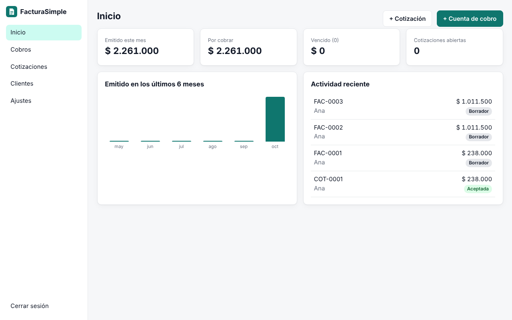

# FacturaSimple

Cotizaciones y cuentas de cobro para pequeños negocios y trabajadores independientes de Latinoamérica. En español, sin mensualidades y en tu propio servidor.

<!-- Cuando Hostinger abra su programa para desarrolladores, pega aquí el botón con tu código de referencia:
[](URL_DE_IMPLEMENTACIÓN_CON_TU_CÓDIGO)
-->



## Qué hace

- **Cotizaciones** que conviertes en cuenta de cobro con un clic.
- **Cuentas de cobro** con IVA por línea, descuento, fecha de vencimiento y abonos parciales.
- **PDF** listo para descargar o imprimir, con tu logo y tus datos de pago.
- **Envío por WhatsApp** con un enlace para que tu cliente vea y descargue el documento sin crear cuenta.
- **Clientes** guardados con NIT o cédula, teléfono y dirección.
- **Inicio** con lo emitido en el mes, lo que te deben y lo vencido.
- **Moneda y formato** de Colombia, México, Perú, Chile, Argentina, España y otros.
- **Copia de seguridad** y restauración en un clic.
- **Sin dependencias**: solo necesita Node.js 18 o superior. No usa base de datos externa.

> ⚠️ **Importante: no es factura electrónica.** FacturaSimple genera cotizaciones, cuentas de cobro y documentos de cobro en PDF. **No emite factura electrónica de venta ante la DIAN** ni ante otras autoridades tributarias (SAT, SUNAT, SII, AFIP/ARCA…). Si tu negocio está obligado a facturar electrónicamente, usa un proveedor autorizado para eso. Puedes cambiar el nombre del documento en *Ajustes*; si eliges "Factura", el PDF incluye una nota aclarando que no es factura electrónica.

## Instalación

### Opción 1: Docker (recomendada, ideal para un VPS)

```bash
git clone https://github.com/Gestiiona/factura-simple.git
cd factura-simple
cp .env.example .env      # edita ADMIN_PASSWORD
docker compose up -d
```

Abre `http://IP-DE-TU-SERVIDOR:3000` y entra con la contraseña de `ADMIN_PASSWORD`.

### Opción 2: Node.js

```bash
git clone https://github.com/Gestiiona/factura-simple.git
cd factura-simple
ADMIN_PASSWORD="tu-contraseña-segura" npm start
```

### Variables de entorno

| Variable | Para qué sirve | Por defecto |
|---|---|---|
| `ADMIN_PASSWORD` | Contraseña del administrador (mínimo 8 caracteres). **Defínela siempre.** | — |
| `PORT` | Puerto del servidor | `3000` |
| `DATA_DIR` | Carpeta donde se guardan los datos | `./data` |
| `SETUP_CODE` | Código fijo para la configuración inicial, si no usas `ADMIN_PASSWORD` | aleatorio |

**Sin `ADMIN_PASSWORD`**, la primera pantalla pide un *código de configuración* que se imprime en los registros (logs) del servidor. Así nadie más puede adueñarse de tu instalación antes que tú.

## Tus datos

Todo se guarda en un archivo `data/db.json`.

- **Docker:** los datos viven en el volumen `facturasimple-data` y sobreviven a reinicios y actualizaciones.
- **Hosting administrado (por ejemplo, Web Apps de Node.js):** comprueba que la carpeta de datos se conserve al volver a desplegar. Si no estás seguro, apunta `DATA_DIR` a una carpeta persistente o usa un VPS con Docker.
- **Haz copias de seguridad** desde *Ajustes → Descargar copia*, sobre todo antes de actualizar.

## Seguridad

- Contraseña guardada con `scrypt` y sesión en una cookie firmada `HttpOnly`.
- Límite de intentos de acceso por IP.
- Los enlaces que compartes con clientes usan un código aleatorio de 128 bits y solo muestran el documento.
- Usa HTTPS en producción. En un VPS puedes ponerlo detrás de Caddy, Nginx o Traefik.

## Actualizar

```bash
git pull
docker compose up -d --build
```

## Licencia

MIT. Úsala, modifícala y compártela libremente.

Hecho por [Gestiiona](https://gestiiona.com).
